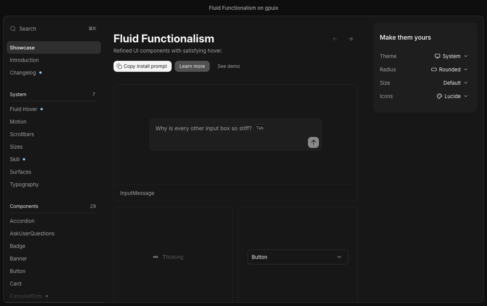
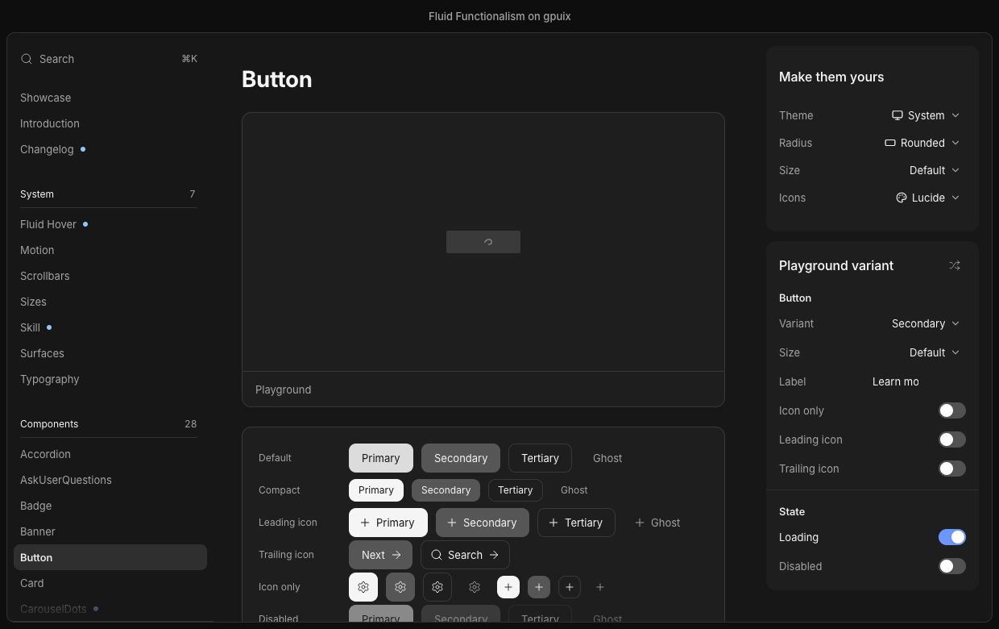
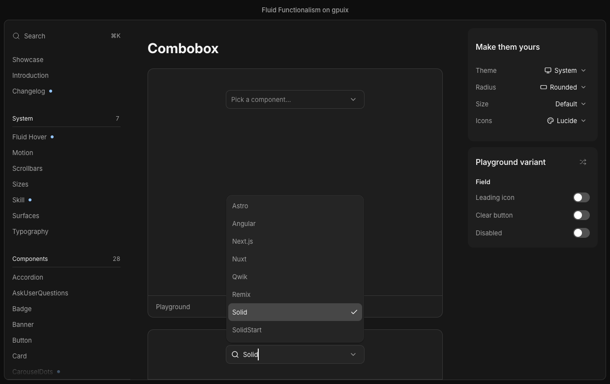
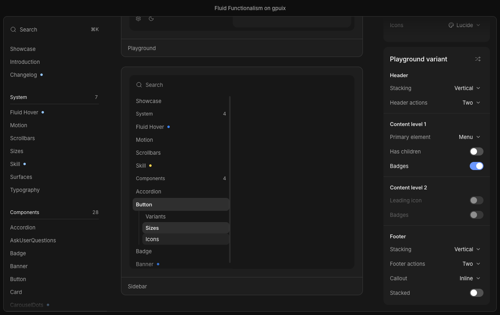

# ghia-fluid-functionalism

Can [gpuix](https://github.com/remorses/gpuix), a GPUI-backed renderer with no DOM and no CSS engine, draw the
[fluidfunctionalism.com](https://fluidfunctionalism.com) component library?

Yes. 32 demo pages cover every component of the library (37 component files, counting shared parts such as
choice-group and menu-item), in the light and dark schemes, with the site's fluid hover, springs and keyboard
behaviour. Around them sit the site's own pages: the home bento grid, Introduction, the seven system pages, Compare
with shadcn, the Concepts mockups, Audio Mixer, and ten doc-page playgrounds. Every place the port looks or behaves
differently from the source is recorded in [Drift from the source](#drift-from-the-source): 495 entries, each tagged
by cause (gpuix gap, port choice or not ported yet).

The components do not carry their own keyboard, selection, open-state and ARIA logic. That comes from
[ghia-base-ui](https://github.com/fdarian/ghia-base-ui), headless Base UI primitives for Solid, which this one
consumes from npm. This repository keeps the styling, the springs and the fluid hover.

| | |
|---|---|
|  |  |
|  |  |

## Run it

```bash
npx ghia-fluid-functionalism
```

Apple Silicon macOS only. The first run downloads the app (about 56 MB) from the GitHub Release, checks its sha256 and
caches it under `~/Library/Caches/ghia-fluid-functionalism/`; later runs start from the cache.
`GHIA_FLUID_FUNCTIONALISM_BINARY_PATH` runs a binary you built yourself instead.

The same package ships the styled Solid components as a library (`ghia-fluid-functionalism/button`, `/theme`, ...), compiled
to `@ghia/solid` universal output with type declarations; [packages/fluid-functionalism/README.md](packages/fluid-functionalism/README.md)
has the install line and an import example.

To work on the code, you need Bun and pnpm. The repository is a pnpm workspace: the components are the library
`packages/fluid-functionalism` (published as `ghia-fluid-functionalism`), the app that shows them is `apps/demo`, and the
root scripts forward to the demo. The renderer and the primitives come from npm (`@ghia/solid`, `@ghia/native`,
`ghia-base-ui`); no other checkout is needed.

```bash
pnpm install
pnpm start
```

The window opens centred in the work area of the first display that is not the primary one; with a single display gpuix centres it.
`FF_DISPLAY=<index>` picks `getAllDisplays()[index]` instead (the order the OS lists them; the primary's index is allowed). An index that is not an
integer in range throws, with the list of displays. `pnpm perf` and `footprint --window` place their windows the same way.

The app is a sidebar (Showcase, Introduction, Changelog, a System group, then one demo page per component, with the New dots of the latest release) plus a "Make them
yours" card with Theme (System follows the OS appearance), Radius, Size and Icons selects. The sidebar's Search row,
or ⌘K / Ctrl+K anywhere, opens the site menu: every page, the theme, a Recent group and a few actions in one field;
Compare, Concepts and Audio Mixer are reached from it. It sits in a browser-style frame: a transparent titlebar with
the traffic lights, a title across the top bar, and the page in a rounded panel. Inter is loaded from
`apps/demo/assets/fonts/`.

```bash
pnpm check                  # turbo: check:type (tsc in both packages, the demo's over src/ and scripts/), then check:scenarios
pnpm check:type             # tsc in both packages
pnpm check:scenarios        # every apps/demo/scripts/check-*, about 30 minutes; runs every check and lists the failures at the end
pnpm screenshots [slug]     # headless captures of every demo and page into apps/demo/screenshots/<slug>/, about 25 minutes for all; or one slug
cd apps/demo
bun scripts/live-check.tsx  # the same flow against the real window, via gpuix's automation client
bun scripts/perf.tsx [slug...] --label name   # live frame times per page, idle and a sidebar sweep, into perf/<name>.json
```

Scripts that run with `bun` start from `apps/demo`, which holds the `bunfig.toml` with the Solid transform and the registry preload.

<details>
<summary>Pinned packages</summary>

- **`@ghia/solid` 0.11.1 and `@ghia/native` 0.11.1** (ghia `730f77f1`), exact versions in `apps/demo/package.json` (the library lists `@ghia/solid` and `solid-js` as peer and dev dependencies and `ghia-base-ui` as a dependency, at the same versions). `@ghia/solid` ships compiled `dist/` with the `preload` and
  `bun-plugin` entries; `@ghia/native` ships the darwin-arm64 `.node` addon and both its ESM and CJS entries. The
  highlights and popups use `@ghia/solid`'s native `motion` springs, and the table, `inline-*`, container query, `has*`
  and `fit-content` layouts, and the variable-font weights, `outlineStyle`, `textWrap`, `textBox` trim and `calc()`
  motion values are its features. The Solid JSX transform is a Bun preload (`apps/demo/bunfig.toml`), so there is no build step.
  `ghia:<path>` refs in these docs are paths in the `fdarian/ghia` repository at `730f77f1`.
- **`ghia-base-ui` 0.1.0** (source `fdarian/ghia-base-ui` at `77a5eb0`, which the `base-ui:` refs in `drift/` and
  `UPSTREAM.md` cite). It publishes `exports` `./*` -> `dist/*/index.js`, so `ghia-base-ui/<folder>` is a primitive.
  Peer dependencies are `@ghia/solid` and `solid-js` at the exact versions the demo and the library pin.
- **One runtime instance.** Two copies of `solid-js` give two reactive systems and nothing updates; two of `@ghia/solid`
  give two renderer registries. `ghia-base-ui` peer-depends on both, so pinning the same versions in both workspace packages keeps one copy of
  each, and always install from this repository's root.
  `apps/demo/scripts/check-single-instance.ts` (one of the `check:scenarios` scripts, also run by `ci.yml`) fails when `solid-js`, `@ghia/solid` or `ghia-base-ui`
  resolves to more than one file from the demo or from the library.
</details>

`apps/demo/scripts/screenshots.tsx <slug>` takes a file name from `apps/demo/src/demos/` or `apps/demo/src/pages/` (or `showcase`) and writes `initial.png`,
whatever the page's `scenarios` capture, `pill.png` (Radius on Pill), `compact.png` (Size on Compact) and `light.png`
(the page after flipping the theme through the real control; a full-layout page or one with its own rail has no theme
select, so the script sets Light in code). It runs on
gpuix's offscreen test renderer, so it needs the native addon but no window. `live-check.tsx` drives the real window
through the automation client and writes to `apps/demo/screenshots/live/`.

## Build the app

Needs `cargo install cargo-packager --locked` once, on top of what "Run it" needs.

```bash
pnpm build    # runs apps/demo/scripts/build.ts; outputs land in apps/demo/
```

| Output | Size | What |
|---|---|---|
| `apps/demo/dist/fluid-functionalism` | 99 MB | The whole app as one binary (`Bun.build` compile, minified) |
| `apps/demo/bundle/Fluid Functionalism.app` | 99 MB | That binary wrapped by `cargo packager` (`apps/demo/packager.json`), with `apps/demo/dist/AppIcon.icns` made from `apps/demo/assets/icon/icon-1024.png`, the site's FF favicon |

About 30 MB of the binary is the `@ghia/native` addon. Launch to first window, measured: 3.2 s the first time, about
1.4 s after.

<details>
<summary>What is embedded, and how</summary>

The binary reads nothing from the repository, so each kind of runtime input has one route in:

- **Demos, pages and the changelog** are the virtual modules `virtual:demos`, `virtual:pages` and `virtual:changelog`
  from `apps/demo/scripts/registry-plugin.ts`, which generate static imports of every file in `apps/demo/src/demos/`, `apps/demo/src/pages/` and
  `apps/demo/content/changelog/`. `bun src/main.tsx` (run from `apps/demo`) uses the same generator, through `apps/demo/scripts/registry-preload.ts` in `apps/demo/bunfig.toml`.
  The build passes `scenarios: false`, so the `scenarios` exports are tree-shaken out; a `process.env.FF_PERF` define
  does the same for `apps/demo/src/lib/perf.ts`.
- **Fonts** are `import ... with { type: 'file' }` (`apps/demo/src/lib/fonts.ts`) and are read from `$bunfs`, Bun's embedded filesystem.
- **Images** go through `diskPath` in `apps/demo/src/lib/assets.ts`: gpuix's Rust image loader reads `` with `std::fs`,
  which cannot see `$bunfs`, so the file is copied to `$TMPDIR/fluid-functionalism-assets/` once per process.
- **The native addon** is embedded by Bun and extracted to `$TMPDIR` at launch. `@ghia/native`'s ESM entry needs a
  workaround for that (`apps/demo/scripts/native-cjs-plugin.ts`; see "Bugs" under the gpuix gaps).
</details>

## Releasing

`pnpm changeset` describes a change; merge the "Version Packages" PR it produces. `.github/workflows/release.yml` then
runs `ci:release` from the root: the library's `build` (tsdown, `packages/fluid-functionalism/tsdown.config.ts`, compiles one entry per library `exports` key into `packages/fluid-functionalism/dist/components/` and `dist/lib/` with `.d.ts`, and the `src/cli.ts` shim into `dist/cli.js`), the demo's
`release:binary` (`apps/demo/scripts/release-binary.ts` compiles and signs the binary, writes `apps/demo/dist/releases/*.tar.gz` and the sha256 in
`packages/fluid-functionalism/dist/checksums.json`), then `changeset publish` puts `dist/` (the library and the shim) on npm. The workflow uploads the tarball
to the `ghia-fluid-functionalism@<version>` GitHub Release. npm authenticates the workflow by OIDC trusted publishing
(`id-token: write`, no token secret), so the package's trusted publisher on npmjs.com must name
`fdarian/ghia-fluid-functionalism` and `release.yml`. `prepublishOnly` refuses a publish outside CI.

## Adding a component

A component adds `packages/fluid-functionalism/src/components/<name>.tsx` (the library), `apps/demo/src/demos/<name>.tsx` (the demo) and `drift/<name>.md`, and edits no shared
file: the library's `exports` map `./*` to `src/components/*.tsx`, so the demo imports it as `ghia-fluid-functionalism/<name>` with no export to add. Library files import each other as `#src/<path>.ts`, with the extension. `apps/demo/src/lib/demo.ts` reads every `apps/demo/src/demos/*.tsx` through the `virtual:demos` module (restart
`--hot` to pick up a new file), and the sidebar lists the demos by title. A demo file exports:

```ts
export const title = "Button";
export const group = "Components";
export function Demo(): JSX.Element {}              // one or more <DemoCard>s from src/lib/demo-kit
export const scenarios: DemoModule["scenarios"] = async (shot) => {};  // optional
```

`scenarios` drives `screenshots.tsx` with `shot.hover / click / down / up / press / moveTo / clickAt / scroll /
settle / expectText / capture`; see `ShotContext` in `apps/demo/src/lib/demo.ts`. Give elements a `testId` to target them.
An element inside a culled region is not built: `getBuiltElementBounds` returns null for it, and `getElementBounds` forces the skipped subtree and answers, so it cannot tell hidden from shown. `shot.reveal(testId)` first when a scenario scrolls toward one.
`drift/_TEMPLATE.md` is the shape of a drift file.

**Behaviour comes from ghia-base-ui, looks from here.** A component's keys, selection, open state, focus and ARIA
come from a `create*` primitive in `ghia-base-ui/<folder>` (`createSelectRoot`, `createMenuList`,
`createTabsRoot`, ...), which returns state accessors and prop objects to spread on gpuix elements. It has no styling,
tokens or animation. The component here adds what the site owns: tokens from `packages/fluid-functionalism/src/lib/theme.ts`, springs, the popup
chrome (`PopupSurface`, with `POPUP_EXIT_MS` from `packages/fluid-functionalism/src/lib/popup-timing.ts` handed to the primitive as an option), the
focus ring and fluid hover.

- **Fluid hover owns the highlighted row.** Pass `hover.activeIndex` as the primitive's `highlightedIndex` and
  `onHighlightChange(index, reason)` back into the hover; on a keyboard `reason`, call `hover.releasePointer()`. Picking
  the row nearest the pointer in the gap between rows (`pickNearest`) stays in `packages/fluid-functionalism/src/lib/fluid-hover.ts`.
- **A missing primitive goes into ghia-base-ui**, not into this repository (release it, then bump the pin): its `UPSTREAM.md` says how to port one from
  Base UI, and its [BASE-UI-AUDIT.md](https://github.com/fdarian/ghia-base-ui/blob/main/BASE-UI-AUDIT.md) records where it differs.
- **Components of this site's own** (command-menu, sidebar, nav-item, input-message, ask-user-questions, queued-stack)
  take shared helpers from base-ui where their behaviour matches: `moveIndex` and `edgeIndex` from
  `ghia-base-ui/internals/composite`, `createPresence` from `/internals`, `createPointerCapture` from `/utils`.
  Nested folders import the same way: `exports` maps `./*` to `./dist/*/index.js`.

A page (Introduction, a system page, a concept) is a file in `apps/demo/src/pages/` instead: it exports `title`, `group`
(`"Pages"` or `"System"`), `order`, `layout` (`"docs"` keeps the sidebar and right column, `"full"` fills the
window), `listed` (`"sidebar"`, `"menu"` for the site menu only, or `"none"`), `Page`, and optionally `Rail` (the right
column's card in place of "Make them yours"), `scenarios`, `menuIcon` and `menuKeywords`. `PageModule` in `apps/demo/src/lib/demo.ts` is the contract, `usePageNav()` from
`apps/demo/src/lib/page-nav.ts` navigates, and `apps/demo/src/lib/doc-page.tsx` holds the shared doc chrome.

<details>
<summary>Shared code in <code>src/lib/</code></summary>

The library (`packages/fluid-functionalism/src/lib/`) holds `theme.ts`, `icon.tsx`, `icons.ts` and `icons/`, `fluid-hover.ts`, `fluid-highlight.tsx`, `focus-ring.tsx`, `measured-height.ts`, `offset.ts`, `popup.tsx`, `popup-timing.ts`, `press.tsx`, `preview-pill.ts`, `stable-label.tsx`, `surface-context.ts`, `cull.ts` and `platform.ts`; the demo (`apps/demo/src/lib/`) holds the rest. The demo imports the public ones as `ghia-fluid-functionalism/<name>` (`theme`, `icon`, `icons`, `icons/*`, `fluid-hover`, `fluid-highlight`, `stable-label`, `measured-height`, `cull`, `platform`).

| File | What it holds |
|---|---|
| `theme.ts` | Both columns of every `light-dark()` in `app/globals.css` (`color-mix()` mixed offline), type scale, radii, springs. `color.x` reads a `scheme` signal, so a JSX prop that touches it re-colours on a theme change; read tokens inside JSX or a function, never at module scope. `withAlpha`, `surface(level)`, `focusRing(offset)`, `capTrim` and `clippedCapTrim` (the source's `text-box` trim). |
| `theme-fade.tsx` | `changeTheme(choice)`, what the Theme select, menu rows and Surfaces links call: mounts the 180ms colour cross-fade layer (`<ThemeFade />`, a `UniversalStyle`), flips the palette a frame later and drops the layer after 200ms. `setThemeChoice` still cuts at once, for captures and checks. |
| `fluid-hover.ts`, `fluid-highlight.tsx` | The site's `use-fluid-hover`: rows register with a `ResizeObserver`, their boxes are read with `getBoundingClientRect` when one reports (every hover reads first, the writes wait for the end of the delivery), divided by the scale the container's transforms give its box (the box over the layout size its observer reported) so a popup that is still scaling in measures the same rows as one at rest, and rounded like the source's `offset*`, the container's rect is read on every pick like the source's (no cache), `pickNearest` (ported verbatim) resolves the pointer to a row including gaps, and one highlight glides between rows. `hover.containerProps` and `useHoverItem` wire a list. |
| `focus-ring.tsx` | The shared keyboard focus ring of accordion groups, tabs, tabs-subtle, checkbox, radio, select and the sidebar menu: one outline box 2px outside the focused row that springs between the rects fluid hover measures. `createFocusRing(hover)` collects `onFocus` / `onBlur` from the rows and counts only `event.focusVisible`, so a click draws none; the ring fades out 60 ms after the last blur and appears in place, not travelling from where it was. |
| `measured-height.ts` | A box whose height springs to its content's measured pixel height, as the source's do: the content box reports its size through `onLayout`, rounded to a whole pixel as Chrome rounds `offsetHeight`, used by every collapse. gpuix animates `height: "auto"` itself; the port keeps the source's number. |
| `offset.ts` | `toOffsetPx`: Chrome's integer `offset*` (half up) from gpuix's fractional layout sizes; `measured-height.ts` and `fluid-hover.ts` use it. |
| `popup.tsx`, `popup-timing.ts` | Popup chrome on `<anchored fit="flip">` (`PopupSurface`, which takes a `createPresence` from base-ui and keeps its reported side and available height in `createPlacementState`), and the exit durations passed to the primitives. |
| `stable-label.tsx` | A label that gains weight without moving its neighbours: an `inline-grid` holds a hidden normal copy, a hidden semibold copy and the visible one in one cell, so the label is as wide as the wider of the two and keeps its width when the weight changes, and wraps like the source's. The weight eases over 80 ms (`fade` adds the colour to the same transition; `snapWeight` leaves it out for a row the source draws without one); `nowrap`, `truncate` and `trim` (the cap-height `textBox` on both copies) are opt-in. |
| `clock.ts` | One shared, ref-counted frame clock for every JS-driven loop; a subscriber inside a far culled region is skipped, and the timer stops when none is shown. |
| `fonts.ts`, `assets.ts`, `app-frame.tsx` | The Inter 4.0 variable files (upright and italic) passed to `render()` and the test renderer, imported as embedded files; `diskPath`, which turns an embedded file path into one on disk for ``, and the image paths (`AVATAR_JPG`, `OG_PNG`) built with it; the window frame (chrome-coloured bar, rounded page panel). |
| `press.tsx`, `icons.ts`, `icon.tsx` | The press-shrink fill layer; lucide glyphs as SVG strings (`defineIcon` for a component's own). |
| `site-command-menu.tsx`, `install-url.ts`, `platform.ts` | The site menu (a `CommandMenuDialog` of pages, theme, Recent and actions) and the window-wide Mod+K that toggles it, through gpuix's `window` event target; the registry URL the copy action writes; `IS_MAC` and `openUrl`. |
| `demo.ts`, `demo-kit.tsx`, `page-nav.ts` | The demo and page contracts, the card every demo page is made of, and `navigate` / `current` for pages. |
| `cull.ts` | The page scroller's contexts and `createCulling`, which hides a region's content with `content-visibility: hidden` and the size it last laid out at (`containIntrinsicSize: 'auto none'`) while it is far from the scroller (`DemoCard`, `ComponentPreview`, home tiles, every `DocSection`, changelog entries and groups, Audio Mixer cards; regions nest, and a Size change re-measures them), and `OnScreenContext`, which JS loops (`onFrame`, timers) read to hold still while hidden (native loops sleep in gpuix since Round 18, #97); `observeVisibleRatio`, which reports how much of an element shows against the window (the thinking-steps card's start rule). Kept: retained and clipped content still costs a frame (the "Culling" row below). |
| `doc-page.tsx`, `playground.tsx` | The docs chrome (`DocPage`, `DocSection`, `ComponentPreview`, `Code`) and the playground scaffolding (`PlaygroundLayout`, `PlaygroundPanel`, the control rows, the right-rail slot). |
| `icons.ts`, `icons/` | The Icons row: one glyph table per library, `iconSource` reads the picked one. |

Presence, list navigation (`moveIndex`, `revealRow`), typeahead, pointer capture, the hidden form value and the modal
`aria-hidden` marking are in ghia-base-ui (`internals/`, `floating-ui-solid/`, `utils/`), not in this folder.
</details>

## Drift from the source

The source is fluidfunctionalism.com at commit `0a0377e` (mickadesign/fluidfunctionalism, "Merge pull request #69");
a copy is kept at `~/.claude/notes/ff-source/`. Each file in [`drift/`](drift) lists every place the port looks or
behaves differently from it, whatever the cause. A cause is one of: **gpuix gap**, gpuix lacks it or gets it wrong;
**port choice**, the port differs on purpose; **not ported yet**, nothing stops the port doing it. An entry is a `## `
section with a Cause line, counted once; one that names two causes counts as mixed; one with no cause tag (an exact
or additive note) is not counted. `bun scripts/drift-counts.ts` (from `apps/demo`) prints the table below from the drift files. Base UI
behaviour, row by row, is in [`BASE-UI-AUDIT.md`](https://github.com/fdarian/ghia-base-ui/blob/main/BASE-UI-AUDIT.md) in the ghia-base-ui repository. Files named after a component are that
component's drift; `site` is the shell, and `home`, `introduction`, `compare`, `concepts`, `audio-mixer`,
`nav-menu`, `fluid-hover`, `motion-page`, `scrollbars-page`, `sizes-page`, `skill-page`, `surfaces` and
`typography` are the pages.

| Component or page | gpuix gap | port choice | not ported yet | mixed | total |
|---|---:|---:|---:|---:|---:|
| [accordion](drift/accordion.md) | 1 | 9 | 6 | 0 | 16 |
| [ask-user-questions](drift/ask-user-questions.md) | 0 | 4 | 6 | 3 | 13 |
| [audio-mixer](drift/audio-mixer.md) | 0 | 3 | 0 | 0 | 3 |
| [badge](drift/badge.md) | 0 | 3 | 0 | 0 | 3 |
| [banner](drift/banner.md) | 3 | 4 | 6 | 0 | 13 |
| [button](drift/button.md) | 2 | 4 | 1 | 1 | 8 |
| [card](drift/card.md) | 0 | 7 | 6 | 0 | 13 |
| [carousel-dots](drift/carousel-dots.md) | 1 | 5 | 1 | 0 | 7 |
| [chat-message](drift/chat-message.md) | 1 | 5 | 1 | 1 | 8 |
| [checkbox-group](drift/checkbox-group.md) | 0 | 0 | 3 | 1 | 4 |
| [color-picker](drift/color-picker.md) | 1 | 5 | 15 | 1 | 22 |
| [combobox](drift/combobox.md) | 2 | 13 | 5 | 2 | 22 |
| [command-menu](drift/command-menu.md) | 2 | 3 | 12 | 1 | 18 |
| [compare](drift/compare.md) | 1 | 9 | 1 | 1 | 12 |
| [concepts](drift/concepts.md) | 1 | 26 | 2 | 1 | 30 |
| [dialog](drift/dialog.md) | 1 | 3 | 2 | 1 | 7 |
| [dropdown](drift/dropdown.md) | 1 | 5 | 11 | 1 | 18 |
| [file-thumbnail](drift/file-thumbnail.md) | 1 | 5 | 1 | 0 | 7 |
| [fluid-hover](drift/fluid-hover.md) | 3 | 5 | 2 | 1 | 11 |
| [home](drift/home.md) | 1 | 4 | 0 | 1 | 6 |
| [input-copy](drift/input-copy.md) | 0 | 3 | 3 | 0 | 6 |
| [input-group](drift/input-group.md) | 0 | 1 | 3 | 1 | 5 |
| [input-message](drift/input-message.md) | 3 | 1 | 12 | 4 | 20 |
| [introduction](drift/introduction.md) | 0 | 5 | 2 | 0 | 7 |
| [mobile-drawer](drift/mobile-drawer.md) | 2 | 2 | 1 | 0 | 5 |
| [motion-page](drift/motion-page.md) | 0 | 3 | 1 | 2 | 6 |
| [nav-menu](drift/nav-menu.md) | 0 | 5 | 1 | 0 | 6 |
| [queued-stack](drift/queued-stack.md) | 2 | 3 | 2 | 1 | 8 |
| [radio-group](drift/radio-group.md) | 0 | 2 | 2 | 0 | 4 |
| [scroll-area](drift/scroll-area.md) | 1 | 5 | 1 | 1 | 8 |
| [scrollbars-page](drift/scrollbars-page.md) | 0 | 4 | 2 | 0 | 6 |
| [select](drift/select.md) | 3 | 3 | 6 | 2 | 14 |
| [sidebar](drift/sidebar.md) | 0 | 8 | 19 | 1 | 28 |
| [site](drift/site.md) | 3 | 14 | 21 | 7 | 45 |
| [sizes-page](drift/sizes-page.md) | 0 | 5 | 3 | 3 | 11 |
| [skill-page](drift/skill-page.md) | 1 | 5 | 0 | 1 | 7 |
| [slider](drift/slider.md) | 3 | 3 | 2 | 1 | 9 |
| [surfaces](drift/surfaces.md) | 2 | 4 | 4 | 2 | 12 |
| [switch](drift/switch.md) | 0 | 1 | 2 | 1 | 4 |
| [table](drift/table.md) | 0 | 1 | 3 | 0 | 4 |
| [tabs-subtle](drift/tabs-subtle.md) | 0 | 3 | 2 | 0 | 5 |
| [tabs](drift/tabs.md) | 0 | 2 | 2 | 0 | 4 |
| [thinking-indicator](drift/thinking-indicator.md) | 1 | 2 | 1 | 0 | 4 |
| [thinking-steps](drift/thinking-steps.md) | 2 | 4 | 5 | 0 | 11 |
| [tooltip](drift/tooltip.md) | 0 | 6 | 1 | 0 | 7 |
| [typography](drift/typography.md) | 2 | 2 | 1 | 3 | 8 |
| **Total** | **47** | **219** | **183** | **46** | **495** |

### gpuix gaps across components

These are the gpuix gaps that hit several components; the per-component files link here. They are as of
`@ghia/solid` 0.11.1 (ghia `730f77f1`; `ghia:docs/fork/index.md`): what the port used to work around and gpuix now does (tables,
`inline-*`, container queries, `has*` states, `fit-content`, variable fonts, `text-wrap`, `text-box-trim`, `calc()` in motion, fractional text widths and rects, authored lengths that keep their fraction (a `top: 110.5` lands at 110.5), the cap-trimmed label baseline (also in a block's strut: tabs-subtle's unfolding label), an atomic inline at its fractional origin (that baseline and the Beacon badges now sit exactly where Chrome's do), a forced layout (a bounds read, a `scrollTop` write) that delivers no `onLayout` or `ResizeObserver` report before the next painted frame's scroll events, a non-finite `scrollTop` read as 0 and a scroll-only write on a `<virtual-list>`, timers between frames, bounds reads without a layout pass, SVG stroke keyframes, playback controls on a motion value's animation, a `scrollTop` write that lays out only what is pending, a scroll end at exactly `scrollHeight - clientHeight`, `WebkitFontSmoothing: 'antialiased'`, an idle window that wakes 0 times a second, an unfocused visible window at the display rate, a `border-color` transition on a collapsed-table part, which lays out nothing and patches with the table as its unit, and, from Round 14a, paint patching of a loop next to an `<input>` or `<textarea>` and under its caret (#74), under a positioned or translucent ancestor or on an absolute element (#75), on a motion value (#76) and on an `<svg>`, whose shapes sleep with it when it is culled) is gone from this list. "Bug" means gpuix does something wrong or inconsistent; "missing" means it does not
offer it. A count is given only where the code shows it.

#### Bugs

| Used by | What | Workaround here |
|---|---|---|
| command-menu, and any list that keeps focus in a field while it is pressed | On Windows and Linux the press reaches JavaScript through a queue after native has already moved focus, so `preventDefault()` in `onMouseDown` or `onPointerDown` has no effect and a press on something not focusable still blurs the field (`ghia:docs/reference.md:4807-4813`). Seen in the command menu: clicking a tab blurs the field. macOS and the test renderer apply it | `preventDefault()` in `onMouseDown` on the list and the tab row (`drift/command-menu.md`); it works on macOS only. Not run on Windows or Linux |
| slider | A function-form `createTransform` of several values is computed in JS and can trail its inputs by one frame (`ghia:docs/fork/deviations.md:166`, `ghia:docs/reference.md:2469-2472`); not seen in the test renderer | `calc()` strings in function-form transforms only where two values mix, range-form (native) otherwise (`drift/slider.md`, "Layers that mix two motion values") |
| select, combobox | Enter in a form with two or more `<input>`s submits nothing: gpuix has no submit button, so HTML's fallback applies (`ghia:docs/reference.md:4485-4492`), and `FormValue` is a second `<input>` in every form that names a Select or Combobox. Enter in a lone `<input>` does validate and submit (an empty `required` one fires `invalid`; measured on the test renderer) | The demos submit through `requestSubmit()` |
| any `<input>` with `textAlign: "right"` (the Button playground's Label field) | The style is accepted and does nothing in the test renderer (`drift/button.md`, "Playground: no Active switch, Label field not right-aligned"); unverified in a live window | none: left-aligned |
| dropdown search field | gpuix ignores the scroller's padding when it pins a sticky box (`drift/dropdown.md`, "Search field is a child of the scroller"). At rest it agrees with Chrome (y 54 in a `padding: 4` scroller at y 50); after scrolling, gpuix pins the box at the scrollport edge (y 50) where Chrome holds it at the scroller's padding edge (54). A sticky box with no negative margin differs the same way (270 against 274), so the margin is not involved. Measured on the test renderer | The scroller has no padding: the field is its first child, ahead of the padded list |
| banner (the actions, `drift/banner.md`, "Action order follows the written order") | Tab order follows the painted order under flex `order`: three `tabIndex={0}` boxes with `order` 3, 2, 1 are visited c, b, a, where Chrome (and CSS) keeps the markup order a, b, c. gpuix's own docs say otherwise: tab order "stays in document order" (`ghia:docs/reference.md:7283`, `:7316`; the `order` style comment, `packages/native/js/host.ts:561-562`; `packages/native/src/layout/order.rs:6-11`, whose sort is at `:22`, says focus and tab order never read the sorted list) | `row` and `row-reverse` instead of `order`, which keeps the written Tab order (`packages/fluid-functionalism/src/components/banner.tsx:460-508`); placement follows position, not variant |
| banner (the actions) | `order` inside an `'@container'` block is ignored: the parent sorts its children by the style it reads without the block, so a container query cannot reorder | The narrow layout switches `flexDirection` in the block instead of `order` (`packages/fluid-functionalism/src/components/banner.tsx:502`) |
| screenshots, app-frame | The test renderer opens its window with the options, but a capture is the view alone: no titlebar or traffic lights (`ghia:docs/reference.md:9299`) | Captures show no traffic lights |
| screenshots | Batched keystrokes deliver an input's `onChange` after the whole batch | none |
| the compiled binary (`pnpm build`) | `@ghia/native`'s ESM entry loads the `.node` addon through `createRequire(import.meta.url)`, which `bun build --compile` does not follow: the binary fails with "Cannot find native binding". Its CJS entry uses a plain `require`, which Bun embeds | `nativeCjsPlugin` in `apps/demo/scripts/build.ts` resolves `@ghia/native` to `index.cjs` |
| every native loop on a page with many nodes: thinking-indicator, thinking-steps, file-thumbnail, carousel-dots, button, and the showcase, fluid-hover and changelog pages that run one | A looping native animation costs the whole page per tick (gpuix "per-replayed-root cost"): `~/.claude/notes/ff-gpuix-repros/r7-frame-loop-starves-timers.tsx` with one looping colour keyframe on one text takes 7 ms a tick on 3000 nodes and about 60 ms on 12000, against 0.1 ms with nothing animating. Timers still run between those ticks (9-10 callbacks a second at 3000 nodes, 7-8 at 12000; gpuix #56), but a page with a running loop idles at 37-45% CPU (carousel-dots, file-thumbnail, thinking-indicator, thinking-steps, queued-stack, showcase, fluid-hover, changelog, and button since its loading spinner is native: the source's always-loading Saving button takes the page from 3.8% to 41%). The cost follows the page's node count, not the animated element: `~/.claude/notes/ff-gpuix-repros/r13-one-loop-costs-whole-page.tsx` (gpuix 83bab5a7, test renderer, load 40-73) measures 2.2 / 6.5 / 26 ms of CPU a draw at 1.3k / 5.2k / 20.8k elements for one 6-24 px animated element, within 5% across colour, SVG dash, SVG `d`, width and absolute `top`, against 0 draws a second with nothing animating. On 83bab5a7 every kind paid a layout pass and the prepaint walk per draw (`layouts/s` equals `draws/s`; retention kept the build to 3 elements a frame), and at 20.8k elements the loop fell to 30 draws a second against the 75 Hz clock. Round 12 (gpuix 196d69ce, `ghia:docs/fork/patch-frames.md:40-73`) patches a paint-only tick (colour, opacity, SVG stroke dash or shape) in its own unit of at most 256 elements, 0.6-1.0 ms a tick live: r13 with no positioned header (load 4-9) patches colour, SVG dash and SVG `d` at 0.24-0.47 ms and 2-4% CPU at every N, while width and absolute `top` stay whole frames at ~70% of a core at 20.8k elements. FF's pages still draw whole frames on 196d69ce: before cc294fcf, headless `pnpm footprint` (load 3-6) read patched/s 0 on all nine animated pages, because each carried one of three blockers (`ghia:docs/fork/patch-frames.md:147-150`). After cc294fcf eight of nine still do: thinking-indicator now patches 61.5 ticks a second (10.6% CPU, headless, load 8-9, apps/demo/perf/footprint-g196-after-c.json). (a) Any `<input>` or `<textarea>` on the page, even culled (only `display: none` spares it), makes every tick `Unsteady`: button (the PlayText input), queued-stack (the composer textarea) and showcase (eight inputs); see the input row below. (b) An animated element under a `position: relative` / `absolute` or `opacity < 1` ancestor is declined as `UnknownUnit`: the button's press surface, spinner wrapper and inert opacity, and file-thumbnail's spinner overlay; see the positioned-ancestor row below. FF stacks ThinkingIndicator's words in one grid cell and positions a word only while it rolls, as the source's inline-grid slot does (cc294fcf): the thinking-indicator page goes from 18% with every tick whole (UnknownUnit) to 10% with 62 ticks a second patched and 6 whole (the rolls), headless on 196d69ce at load 6–8. (c) Active motion values, which stay full frames: carousel-dots' fill and the plain-vs-fluid cursor on fluid-hover and changelog, which the source animates with transforms (gpuix had none then; FF puts all of them on transforms since 667084d0, see the last paragraph of this row). Knockouts that remove every blocker from a page read button 25 to 4.5% CPU, thinking-indicator 16.5 to 9.6%, queued-stack 20.5 to 7.4% and file-thumbnail 11.9 to 8.0%. FF's headless knockouts (`pnpm footprint`, gpuix 83bab5a7, load 7-28; cost is draws a second times the whole-page draw ms) find one live loop is enough to keep the page drawing: one Saving spinner is 30.6% of the button page's 35.3%, the showcase's ThinkingIndicator tile alone is its whole 42% (the carousel tile is culled headless), and fluid-hover's cursor loop is its whole 27%. The owner accepted the button's ~41% idle CPU then; on c6475390 it is 3.7%. Round 14a (gpuix c6475390, zed 5a7b70d193; #74, #75, #76 and SVG patching, `ghia:docs/fork/patch-frames.md:147-150`) answers blockers (a) and (b) and the motion values of (c) that are not layout: headless `pnpm footprint` on the ten animated pages, FF 103c5ab4 on 196d69ce (`apps/demo/perf/footprint-g196-after-{a,b,c}.json`) against FF cdf48232 on c6475390 (`apps/demo/perf/footprint-c647-after-{1,2}.json`, two chunks at load 2.7-13.9, so CPU is indicative), CPU / patched a second / whole frames a second / top reason: showcase 32.4 to 18.0% / 0 to 62.0 / 67.1 to 5.6 / `Unsteady` to `LayoutAnimation`, button 25.9 to 3.7% / 0 to 0 / 66.8 to 0 / `Unsteady` to none (it draws nothing), changelog 19.5 to 29.4% / 0 to 0 / 67.3 to 67.7 / none to `LayoutAnimation`, fluid-hover 21.5 to 25.9% / 0 to 0 / 71.7 to 67.7 / none to `LayoutAnimation`, queued-stack 19.1 to 17.6% / 0 to 62.3 / 71.5 to 5.7 / `Unsteady` to `LayoutAnimation`, thinking-indicator 10.6 to 20.6% / 61.5 to 62.0 / 5.8 to 5.9 / `Outside` to `LayoutAnimation`, thinking-steps 7.4 to 5.6% / 0 to 0 / 13.8 to 4.6 / `Outside` to `LayoutAnimation`, file-thumbnail 12.4 to 8.7% / 0 to 67.9 / 71.7 to 0 / none, carousel-dots 16.8 to 24.9% / 0 to 0 / 64.7 to 67.7 / none to `LayoutAnimation`, input-message 2.3 to 5.6% / 0 / 0 (the dormant-tick row below). Over the 49 pages both runs share, summed CPU is 195.2 to 208.3% and footprint 4001 to 3843 MB; the static pages' median CPU is 0.6 to 1.2%. The whole frames that remain are layout, which gpuix still draws whole (`LayoutAnimation`, `ghia:docs/fork/patch-frames.md:50`, `:228`): ThinkingIndicator's word roll on `top` (~5 a second, `packages/fluid-functionalism/src/components/thinking-indicator.tsx:226-228`), the fluid-hover cursor on `top` (~51 a second, `apps/demo/src/pages/fluid-hover/parts.tsx:155-165`, `apps/demo/src/pages/fluid-hover/plain-vs-fluid.tsx:126-131`; the changelog mounts the same stage through `apps/demo/src/pages/changelog/previews.tsx:15`) and carousel-dots' fill on `width` (~66 a second, `packages/fluid-functionalism/src/components/carousel-dots.tsx:107`, `:212`), all three the missing-transforms gap of the time (answered by gpuix Round 25 and slice 9, see the last paragraph of this row). The one such loop the source owns is thinking-steps' step `height` spring (~2 a second, `packages/fluid-functionalism/src/components/thinking-steps.tsx:311-315`; the source springs `height` too, `registry/base/thinking-steps.tsx:399-403`): a gpuix cost, not a gap. Two commit streams stay whole by design: `Edited` ~0.5-0.9 a second on the three ThinkingIndicator pages is the word timer's text commit (the source changes the word too), and `PendingView` ~10 a second on fluid-hover and changelog is the row-hit commits from `createMotionValueEvent(cursorY, 'change')` (`plain-vs-fluid.tsx:136-142`), where the source does the same per-frame work (`app/docs/fluid-hover/demos.tsx:332-341`) and gpuix draws a tick with a commit whole. Per-frame draw time is about 1.4 ms higher on c6475390 for the same frames and is not attributed (see the dormant-tick row). On gpuix ae559246 (FF 8473c4ea, headless, compiled child run directly: `/usr/bin/footprint` hung for every pid on this machine, so memory is the child's RSS from `ps`, not phys_footprint; two runs each at load 3-4.4; CPU / patched a second / whole frames a second / whole-frame reasons): showcase 17.0% / 65.9 / 1.8 / `Edited`, `Ended`, `Sourced`, and `Surroundings` and `Operations` declines (the word timer's text commit), button 1.6% / 0 / 0 (draws nothing), changelog 11.6-18.9% / 50.0 / 17.4 / `Edited` and `PendingView`, fluid-hover 16.3-17.8% / 51.4-52.2 / 15.7-16.4 / the same (the cursor is a `x` / `y` patch now, the whole frames are the row-hit commits of `createMotionValueEvent(cursorY, 'change')`, ~10 a second, and the source does that per-frame work too), thinking-indicator 21.2-22.0% / 65.5-65.9 / 1.8-2.1 / `Edited` (the roll is a `y` patch), thinking-steps 4.6-4.8% / 0 / 5.8-6.0 / `LayoutAnimation` and `Edited` (the step `height` spring, which the source springs too), file-thumbnail 9.2-10.5% / 67.8-68.1 / 0, carousel-dots 10.3-11.2% / 61.8 / 5.6 / `LayoutAnimation` (a box size that springs, owner gpuix like thinking-steps' height; the fill is an `x` patch), input-message 1.9% / 0 / 0, and queued-stack 28.3-28.4% / 0 / 67.6 / `Unsteady` 675 in 10 s, up from 9.7% / 65.6 / 1.8 on the commit before 47982537 (the same compiled-from-source child, same gpuix): `layout="position"` on the chat message (the source's sibling slide, `registry/default/chat-message.tsx`) leaves a box that follows the clock in every tick's last frame, so no tick patches. Whether gpuix should call an idle `layout` box steady is open (`patch-frames.md` lists `Unsteady` as an element that follows the clock). On e31ec048 (FF 5bdfa73c, same child, two runs at load 2.5-3, #113 in): queued-stack 29.4% and 24.8% / 0 / 67.5 and 67.4 / `Unsteady` 674 and 673 in 10 s, so #113 did not change it (the box does not move, and the page still draws whole); `~/.claude/notes/ff-gpuix-repros/idle-layout-unsteady/` shows it with no FF code (a looping opacity box beside a `layout` box that never moves: 150 patched and 0 whole frames without `layout`, 0 and 150 with `position`, `layout` or `size`, reason `NoFrame` there). The other pages with a `layout` box have no running loop headless and draw nothing: chat-message 2.1%, input-message 2.4%, ask-user-questions 2.3% (the restored footer buttons), concepts-atlas 1.8%, concepts-beacon 0.9%, concepts-lumen 0.8%, concepts-quill 2.2% and motion 2.0%, each 0 draws a second; the showcase, whose loops are patched, reads 20.4% / 66.2 / 1.8 as before. On the final poc, gpuix 5f7a9af9 (zed a8c56f06bd; FF 7dcb784c, headless, the compiled child run directly and recompiled for this tree, two runs each, one page per lock hold at load 3-12; CPU / patched a second / whole frames a second / whole-frame reasons): showcase 19.4% and 20.3% / 69.1-69.6 / 1.8 / `Edited` (the word timer's text commit, which the source makes too), `Ended` and `Sourced` (the roll's start and end ticks) and `Surroundings` and `Operations` declines; button 2.0% and 2.1% / 0 / 0 (draws nothing); changelog 22.1% and 19.7% / 54.5 and 53.8 / 17.2 and 17.4 / `PendingView` (~10 a second, the row-hit commits of `createMotionValueEvent(cursorY, 'change')`, work the source does too, `app/docs/fluid-hover/demos.tsx:332-341`) and `Edited`; fluid-hover 19.6% and 20.0% / 54.8-54.9 / 16.6-16.8 / the same; queued-stack 29.1% and 29.3% / 0 / 71.6 and 71.5 / `Unsteady` 715 and 714 in 10 s, unchanged by #113 and #115 and owned by gpuix (the idle `layout` box on the chat message, `~/.claude/notes/ff-gpuix-repros/idle-layout-unsteady/`); thinking-indicator 24.2% and 17.2% / 69.0 and 68.0 / 2.4 and 1.8 / `Edited` (the word timer's text commit again); thinking-steps 4.4% and 4.7% / 0 / 6.4 and 6.3 / `LayoutAnimation` (the step `height` spring, which the source springs too: owner gpuix) and `Edited`; file-thumbnail 12.6% and 10.8% / 71.4 and 70.8 / 0; carousel-dots 12.7% and 11.3% / 65.3 and 64.9 / 6.0 and 5.9 / `LayoutAnimation` (a box size that springs, owner gpuix; the fill is an `x` patch); input-message 1.9% and 2.0% / 0 / 0 (draws nothing). The pages that still draw whole frames are queued-stack (`Unsteady`, gpuix) and, at 2 to 17 a second, the showcase, changelog, fluid-hover, thinking-indicator, thinking-steps and carousel-dots, for the reasons above; button, file-thumbnail and input-message draw none whole. RSS on that poc 155-265 MB (showcase 253-265, changelog 208-260, fluid-hover 223-232, input-message 197-222, queued-stack 202, thinking-steps 184-195, the rest 155-191) | none for the loops: they are native. The off-screen gates are gone (the button Spinner's `onScreen` in 111cbc78, the Shimmer `animation` ternary in 9ff46094, the MorphingGlyph `Show` swap in b62ed145, the file-thumbnail Spinner's in cdf48232), because on c6475390 they cost nothing to remove: an alternated A/B of the gated build (9726e334) against the removed one, two rounds each, read thinking-indicator 19.9 / 21.5% against 21.2 / 20.1%, file-thumbnail 8.9 / 7.2 against 9.4 / 8.7 and button 3.3 / 3.6 against 3.6 / 3.5, with patched and built elements a second equal (`apps/demo/perf/footprint-ab-{pre,post}-{1,2}.json`); the showcase went 19.7 to 18.0%. Culling stays (`packages/fluid-functionalism/src/lib/cull.ts`; the culling row below), and so does the word timer's `onScreen` gate (`packages/fluid-functionalism/src/components/thinking-indicator.tsx:248-250`) |
| button (PlayText input), queued-stack (composer textarea), showcase (eight inputs), and any page with an `<input>` or `<textarea>` next to a paint-only loop | An unfocused, idle input makes every tick of a loop elsewhere on the page a full frame: `getPatchCounters()` reports `Unsteady` at the tick rate. `~/.claude/notes/ff-gpuix-repros/r17-input-makes-page-unsteady.md` (gpuix 196d69ce, test renderer, 3000 nodes = 7.8k elements, two rotated repetitions, load 28 falling to 5.6): one colour loop is patched at 0.4-0.6 ms and 3.9-4.5% CPU; add one `<input>`, a `<textarea>`, a focused input or an input outside the clip (culled) and each of the 67 ticks a second is a full frame at 4.0-4.8 ms and 27.6-32.9%. Only `display: none` keeps the page patched (4.0%), and with nothing animating the input costs nothing (0 draws a second, ~0.9%). the pre-split `FORK.md` (~3054) listed `<input>` and `<textarea>` as never retained, a likely source that r17 did not confirm. Question for gpuix: `Unsteady` from an element that follows the clock in the frame being patched (a focused input's caret), not from an unfocused or culled one Answered by gpuix #74 (c6475390, `ghia:docs/fork/patch-frames.md:181`): the editor is retained (`TextEditorElement::retain_state`, a keyed measure) and the caret is the clock's only source, so an unfocused input is no longer `Unsteady`. Headless on c6475390 (`apps/demo/perf/footprint-c647-after-{1,2}.json`) the `Unsteady` count is gone on all three pages: showcase 670 to 0 with 62.0 ticks a second patched, queued-stack 714 to 0 with 62.3, button 668 to 0 (it draws nothing). | none: the inputs are the source's own |
| button (press surface, spinner wrapper, inert opacity), file-thumbnail (spinner overlay) | A loop in a descendant of a `position: relative` / `absolute` or `opacity < 1` box is declined as `UnknownUnit` on every tick, though the Round 12 text of the pre-split `FORK.md` said only that a relative box is a unit and an absolute one is none. `~/.claude/notes/ff-gpuix-repros/r18-positioned-ancestor-declines-unit.md` (gpuix 196d69ce, test renderer, 7.8k elements, load 8.5-12.9): a colour or SVG dash loop is patched at 0.4 ms and 3.3-3.5% CPU in a plain header; in a `relative`, `absolute` or `opacity: 0.5` wrapper each tick is a full frame at 3.1-5.5 ms and 21.6-33.1%. When the animated element is itself `absolute` there is no unit at all: full frames at 22.8-26.1% with no entry in `declines` or `unpatchable`, so the case cannot be told from a harness that never ticked. FF stacks ThinkingIndicator's words in one grid cell and positions a word only while it rolls, as the source's inline-grid slot does (cc294fcf): the thinking-indicator page goes from 18% with every tick whole (UnknownUnit) to 10% with 62 ticks a second patched and 6 whole (the rolls), headless on 196d69ce at load 6–8. thinking-steps' step wrapper dropped a `position: relative` that anchored nothing (96f4e653); the page itself is unchanged (its draws are JS-driven), an isolated active step goes from 67 whole ticks a second to 67 patched. Question for gpuix: patch under a positioned or translucent ancestor, or document which ancestors cannot be patched under, and count the no-unit case Answered by gpuix #75 (c6475390, `ghia:docs/fork/patch-frames.md:213`): a root under an open lift is a unit (`Placement::Deferred`) and an absolute root is a unit that is recorded and never skipped, so a colour or stroke loop under a `relative`, `absolute` or `opacity < 1` wrapper is a patch (r18: 3.1-3.9 to 0.2-0.4 ms a draw at 7.8k elements). Headless on c6475390 file-thumbnail's spinner overlay patches 67.9 ticks a second and draws none whole; button draws nothing (its loops idle, see the dormant-tick row). ThinkingIndicator therefore keeps `position: relative` on a rolling word at rest like any positioned box (e99b0655): the word patches its shimmer under it at 62.0 ticks a second; what was left whole then was the `top` roll itself, which is a `y` transform and a patch now. | FF keeps the source's structure except where positioning anchors nothing or the source uses none (ThinkingIndicator) |
| any page with a looping animation that is off screen (culled, `content-visibility: hidden` or `display: none`) or has stopped: input-message, button, file-thumbnail, thinking-steps, each seeded `QueuedChat` ThinkingIndicator | A loop that draws nothing still costs about 3.5% CPU. Headless `pnpm footprint` on c6475390 (`apps/demo/perf/footprint-c647-after-{1,2}.json`): input-message, whose looping cards are all culled, went from 0.5-2.3% on 196d69ce to 5.3-5.8% with 0 draws a second, and button 3.5%, file-thumbnail 6-9% and thinking-steps 5% idle with no visible draws. `sample` puts the time under `GpuixView::dormant_tick` -> `sync_motions` -> `renderer::parent_inherited`, which clones a `HashMap<ColorContext, ParentFont>` per motion element per frame (gpuix `packages/native/src/renderer.rs:8593`); 5055368c gave patched ticks `step_motions` (`:8232`) but not `dormant_tick`, whose re-arm is likely near `:8630`. Knockouts: input-message 5.3 to 0.9% without its cards; each seeded `QueuedChat` ThinkingIndicator is ~3.5%; a shimmer or a glyph loop alone keeps it armed (4.7 and 4.6%, both 1.1% with the loop off). FF's old `onScreen` gates did not help (a gated build read 4.3-4.8%). The static pages' median CPU, 0.6 to 1.2%, was not chased. Per-frame draw time is also about 1.4 ms higher on c6475390 for the same frames across six runs (thinking-indicator's patched tick 2.4-3.2 to 3.4-4.6 ms, carousel-dots' 1.3-2.8 to 2.9-3.6 ms), not attributed: `ghia:docs/fork/retention.md:177` documents only a first draw 15% dearer, and gpuix cannot be A/B'd from here. Question for gpuix (owner gpuix): should `dormant_tick` step its motions with `step_motions` and disarm once no dormant run advances? Answered by gpuix #90 (Round 18, poc a92b4f7f, `ghia:docs/fork/patch-frames.md:496-558`): a dormant source says when it next has something to tell (`dormant_wake.rs`) and the window asks for no more, so each sleeping animation schedules its own wake instead of a tick at every frame (`getFrameWorkCounters().dormantTicks`); a motion with no box (`display: none` or a `content-visibility` ancestor) asks for no frame at all. Headless `pnpm footprint` on a92b4f7f (`~/.claude/notes/plans/ff-gpuix-r18-ab.md`, load 1.4-4.3): input-message, whose looping cards are all culled, idles at 1.3-1.6% CPU (5.3-5.8% on c6475390) and button at 1.4-1.8% (3.5%); the ThinkingIndicator and file-thumbnail pages are not read here, since their loops are on screen. | none: the cost was in the renderer and is gone in Round 18, and the loops are the source's |
| input-message, and any page whose looping cards sit in a `content-visibility: hidden` region: ThinkingIndicator's `MorphingGlyph` (a `motion.path` `d` loop) and `Shimmer` (a CSS colour loop per letter) | On gpuix 55ece39b (Round 17) an animation in content that `content-visibility` skips kept the window drawing: input-message on FF's `cull-cv` branch idled at 19.8-22.7% CPU with 71.6-71.8 whole frames a second, against 4.1-6.0% and 0 with the `display: none` culling on `main` (headless `pnpm footprint`, `~/.claude/notes/plans/ff-gpuix-r18-ab.md`). Answered by gpuix #97 (Round 18, poc a92b4f7f, `ghia:docs/fork/patch-frames.md:559-587`): a motion whose host has no box is no running source, so a hover frame no longer rebuilds the path to every skipped host, and a tick that only changes skipped content builds, lays out and presents nothing (`getPatchCounters().emptyTicks`, in neither the patched nor the whole frames). gpuix did not reproduce the 72 a second in its test renderer; FF's own number is the one that closes it: input-message on `cull-cv` b8b4d20b reads 1.3-1.6% CPU and 0 whole frames a second in three runs, the same as `main` 74e0033c (1.4-1.6%, 0) | none: culling hides the content and gpuix lets its loops sleep; only JS loops (`onFrame`, timers that read `useOnScreen()`) still gate themselves on `OnScreenContext` |
| every page, as memory (window floor and tour high-water) | What gpuix still holds per process is the frame buffers, the JS heap and AppKit's colour tables; #79 (gpuix f993d9b9) cut 5 MB of it. Headless `pnpm footprint` on f993d9b9 (load 5.5 falling to 4.4): the introduction is 65 MB (JS heap 8 MB) and the showcase 131 MB (heap 18 MB). After `pnpm footprint --tour` visits every page once (headless, load 4.6 falling to 2.6) the introduction sits at 192 MB, up from 67 MB fresh, with a peak of 194 MB, and leaving a page returns nothing to the OS (a forced GC does not lower it); this is a high-water mark of malloc, JS heap garbage and CoreText instances, not a leak: the retained element count returns to 744. The in-window floor (a one-text window against the introduction) and the cost of a retained element are to be re-measured on the next bench | culling keeps the off-screen loops off; `avatar.jpg` and `og.png` ship at 2x their largest displayed size (9a0e00d9), where the 1200x600 `og.png` decoded to ~2.9 MB |
| every long page on a sidebar click: Changelog, Showcase, Command Menu | A page mounts in one batch and its first draw builds, lays out and shapes every node, far regions included, because nothing marks a region far until an `IntersectionObserver` has reported against a first layout: a 1900-node, 190-line tree draws in 45 ms, the same tree with all but the first 12 entries `display: none` in 8 ms. The line layout cache aged a line out after one frame that looked up other text (`finish_frame`, `zed/crates/gpui/src/text_system/line_layout.rs:1817`), so a revisit shaped the same lines again; gpuix 511bebab's 8 MiB shape store (#71) fixed that: shapes per revisit went from 215 to 8-12 on Changelog, 291 to 4 on Showcase and 142 to 0 on Command Menu. A first visit still shapes every line (211 to 183, 293 to 237, 144 to 138) inside a whole-page layout. Repro and numbers: `~/.claude/notes/ff-gpuix-repros/r11-first-layout-cost.md`. Question for gpuix: a way to mount a region culled before its first layout (`contentVisibility` with `containIntrinsicSize` is the shape of it; FF uses both, but only after the first report, the "Culling" row) | The first draw stays whole, but 511bebab made it cheaper. Median first-draw ms on a first visit / a revisit, f993d9b9 to 511bebab: Changelog 82-83 / 58-62 to 43-50 / 29-35, Showcase 47-51 / 36-38 to 41-44 / 36-37, Command Menu 57 / 48-49 to 47-51 / 41-51 (its mount JS was 340-440 ms on both: each of the page's 11 menus snapped its list with `scrollTop = 0` on its first run, and a scroll write after a mutation is one forced layout pass of ~28 ms over the whole page, see the next row). Measured by `apps/demo/scripts/perf-page-switch.tsx`, headless, on release builds of the two gpuix commits, two runs each, alternated, at load 3-10. `createCulling` hides far regions after its first report, and release-spy defers its first reading past that draw so the page does not lay out twice before it. The Command Menu mount skips the list's first snap (`704af9e5`, `packages/fluid-functionalism/src/components/command-menu.tsx:456-465`; a fresh list is already at 0): mount JS median ~400 to ~41 ms (4 runs of 4 visits each, alternated on one build: 428 / 444 / 337 / 380 before, 51 / 46 / 36 / 30 after), settled ~780 to ~470 ms, at load 7-16. What is left is `navigate`'s own `scrollTop = 0` pass (`apps/demo/src/app.tsx:535`, ~7 ms on 511bebab), the page render (~13 ms) and the mutation flush (~7 ms: JSON stringify 3.3, `applyBatch` 3.9). Round 16 (gpuix e591681e, #83: a forced layout lays out only what is dirty; `apps/demo/scripts/perf-page-switch.tsx`, headless, one process per page, load 2-4) on Changelog / Showcase / Command Menu / Button: a first visit settles in 133 / 283 / 169 / 69 ms (first draw 42 / 54 / 48 / 16), a revisit (median of visits #2-#4) in 103 / 221 / 136 / 60 ms (first draw 27 / 36 / 35 / 15), at 2 layout passes on the first click of Changelog and Showcase |
| any page that writes `scrollTop`, `scrollTo` or a bounds read after a mutation: command-menu (before `704af9e5`), the page-switch `navigate` | A scroll write after a mutation lays out first, so one pass runs per write, and the pass walks the whole retained tree, `display: none` and `contentVisibility: hidden` subtrees included. Even a paint-only change (a colour) costs the full pass at the next write, which a browser would not pay. `~/.claude/notes/ff-gpuix-repros/scroll-setter-layout/README.md` (gpuix 511bebab, test renderer, load 11-22): 1 pass per write for `el.scrollTop = top`, `el.scrollTo({top, left})` and `renderer.scrollTo` alike (1.59 / 1.64 / 1.61 ms at 4000 elements after a width change, 1.09 / 1.08 / 1.04 after a colour change; none after nothing changed), so the one-axis setter is not extra cost. The pass is linear in the tree: 0.46 / 0.84 / 1.73 / 3.48 ms at 1000 / 2000 / 4000 / 8000 elements (~0.4-0.5 us each), unchanged with 90% of them `display: none` (0.53 / 1.02 / 1.94 / 3.68) and 10-20% cheaper with `contentVisibility: hidden` (0.48 / 0.78 / 1.57 / 2.86). On 511bebab FF's pass cost ~5 us per element (~28 ms at ~5.3k elements on the Command Menu page, 20 ms at 4.3k, 5.8 ms at 1.26k), about 10x the repro's. Round 16 (gpuix e591681e, #83) closed that: `check-command-menu`'s probe (a 1 px height toggle on a leaf, 20 reps, one `getElementBounds` read each) costs 1 pass and 2.87 ms median per read on the Command Menu page, in line with the repro's ~0.4-0.5 us per element, and a paint-only write costs no pass (0.05 per read, 0.02 ms median) while the page is culled with `display: none`; with `content-visibility: hidden` it costs a pass (the next row). Question for gpuix: a pass for a layout write that costs what changed, not the tree | Avoid the write while a page mounts: the Command Menu list skips its first `snapScroll(0)` (`704af9e5`). `navigate`'s `scrollTop = 0` (`apps/demo/src/app.tsx:535`) stays, ~7 ms a visit |
| any page that goes fully idle (0 ticks a second), notably Command Menu about 4 s after entry | Input to an idle window did not wake JS on the wake-driven frame loop (gpuix #77): the owner saw lag after ⌘K into the Command Menu until ⌘-Tab away and back. On c6475390 AppKit's NSEventThread hands each WindowServer event to the main thread with `CFRunLoopPerformBlock` + `CFRunLoopWakeUp`, but under the embedder the main run loop is not running (main sits in Bun's kqueue), so no mach message reaches the ports the run-loop wake watches (`zed/crates/gpui_macos/src/run_loop_wake.rs`) and `tick()` / `pump_events` is the only drain. A page that keeps ticking (the showcase, ~100 ticks a second) hides it. `~/.claude/notes/ff-gpuix-repros/f2-idle-input-wake/` (README; gpuix c6475390, `CGEventPostToPid` from a separate process): 15 of 15 events (shift, mouse move, click, scroll) sat in AppKit's queue with no wake in 600 ms, while a main-queue block woke JS in 0.1 ms 6 of 6 times. Answered by gpuix #93 / Round 14c (poc 6f2a72d3, zed bf26cbb68a; `ghia:docs/fork/frames-and-wakes.md:168`): a `kCFRunLoopBeforeWaiting` observer on NSEventThread's run loop posts a no-op block to the main queue. gpuix's numbers: input wakes JS in 0.1-1.4 ms and reaches the handler in 0.4-7.7 ms, and an idle window still makes 0 wakes; `postEvent:` from a non-main thread still does not wake, but real input never takes that path. The owner confirmed the fix with real input on 2026-10-24 ("no noticeable lag"), so the real-input check is done. Since gpuix Round 21 (#95) the test renderer has the live wake surface (`postNativeEvent`, `setFrameWakeCallback`, `requiresTick`, `tick`; gpuix `docs/fork/testing.md`, "Waking JS for input (#95)"), so the regression is a headless check: `apps/demo/scripts/check-idle-input.tsx` (part of `pnpm check:scenarios`) mounts the Command Menu page, runs `startFrameLoop` on the wake path with no timer, waits until the window makes no wake (0 wakes over 2 s, after the startup bursts), then posts a click on the input, a key down, a mouse move over a row and a wheel over the list through AppKit's queue, each after another idle wait. Each must wake JS (0.1-1.7 ms) and show its effect without any other wake (input focused, the list filtered, the row highlighted, the list scrolled; 65-130 ms, the hover and scroll springs included). A final control stops the loop and posts again: the event stays queued. With the wake never reaching JS, as without the NSEventThread observer, all four fail (run with the callback not forwarded: 8 FAIL) | none: FF needs gpuix 6f2a72d3 or later, pinned in 752e0b30; `apps/demo/scripts/check-idle-input.tsx` guards it |
| home bento tiles in a one-column window (`apps/demo/src/home/bento-card.tsx:88`) | Not a gpuix bug (gpuix #89, Round 17, poc 55ece39b): Chrome's oracle matches gpuix, so under `containIntrinsicSize: auto` the remembered size is the content box of the last rendered layout, and the declared size until then. 921 px is the ask-user-questions tile's settled height at a one-column 700 px window (FF main with culling off is 921 too). The 305 on the `cull-cv` branch's A/B (the "Culling" row) was FF's own `flexBasis` pin, `culling.farHeight()` while far, which read an `IntersectionObserver` rect sampled mid-spring; 5c7b3f44 dropped it with the `display: none` wrapper. Headless (Round 17 and again on a92b4f7f, 700x780 window, one sample each): with the pin, unseen tiles started at 305 / 595 / 247 (ask-user-questions / accordion / thinking-steps) and the grid grew 9503 to 10935 as you scrolled; with `content-visibility: hidden` every tile holds 921 / 931 / 727 and the grid 10935 px right after settle. Unchanged on 667084d0 (Round 26, #96 fixed; headless, 700 px window, `'0%'` basis): card-ask-user-questions 921, card-accordion 931, card-thinking-steps 727, the grid 10935 | none needed from gpuix; the home grid's scroll height is the final one from the first settled frame, no longer an estimate |
| home bento tiles, the card's preview box (`apps/demo/src/home/bento-card.tsx:88`) | Fixed in gpuix Round 26 (667084d0, #96). `flexBasis: 0` or `0px` on an item of an auto-height column flex container collapses to its padding in Chrome (173 px in gpuix's repro), and gpuix sized it from content (305 px); an auto-height flex column is now the sum of its items' hypothetical sizes, and the repro reads 173. Measured in FF (headless test renderer, 700x780 window, one column): with `flexBasis: 0` every tile collapses, to 175 px (command-menu 111 px) and the grid to 4637 px; with `'0%'`, the source's `flex-1` (source `app/components/bento-card.tsx:100`), the tiles keep their content height (card-ask-user-questions 921, card-accordion 931, card-thinking-steps 727, card-thinking-indicator 211, card-input-message 259, card-command-menu 551; the grid 10935 px) | none: the preview box writes `flexBasis: '0%'`, and the tiles read as in Chrome |

#### Missing features

| Used by | What | Workaround here |
|---|---|---|
| every transform in the port (`motion.*` `x`, `y`, `scale`, `rotate`, `scaleY`, the CSS `rotate` / `translate` / `transform`) | None left that the source uses and gpuix lacks: gpuix has transforms since 667084d0, and FF puts each of the source's on the same key, spring and origin. FF uses none of what gpuix still lacks around them (the planes of a 3D context are not depth-sorted, `element.animate()` does not exist, a rotated clip inside a rotated clip is loose; gpuix `docs/fork/deviations.md`, "Paint and transforms"). What remains is in the two rows below, the `layout` row (the size morph, at the end of this table) and one port choice: the dropdown's RTL chevron mirror (`rtl:-scale-x-100`) stays out because the port has no direction context for it to read (`drift/dropdown.md`), though gpuix has `direction` | none |
| select, combobox, dropdown, color-picker (`packages/fluid-functionalism/src/lib/popup.tsx`) | `var()` in a Motion key and an `initial` that follows a signal. The source enters on `y: var(--popup-enter-y)`, set from the resolved `data-side` and read when the tween starts, after the positioner has landed (`registry/default/lib/popup.ts:16-23`); gpuix substitutes `var()` only in the CSS transform properties, not in Motion keys or its `transform` target | The popup enters on `y` ±4 from the side it asked for; a popup that then flips starts its first open with the other side's slide, 4 px at opacity 0 to 1 over 80 ms. From the second open the reported side is known (`drift/select.md`) |
| every popup, entrance and queued card that scales | Text under an animating transform is rasterized at a scale rounded up to the next power of root two and drawn through the matrix, then rasterized again through the exact one when the run ends, as Chrome composites an animating layer at a fixed raster scale; the scale Chrome picks and when it re-rasters are not compared (gpuix `docs/fork/deviations.md`, "Transforms: text in an animating transform is resampled"). Not measured in FF: a spring's last frames may shift a glyph by a pixel on the re-raster | none; the screenshots and checks read the box at rest, where the matrix is exact |
| slider | `<input type="range">` (Base UI audit row 312) | A pointer-handled track and thumbs |
| select, combobox (`FormValue`) | `<input type="hidden">` | A real input that is invisible, unreachable and `aria-hidden` |
| banner (the description layout), surfaces (the elevation stack) | Selector `:has(.x)` and group-has. gpuix has `hasHover`, `hasActive`, `hasFocus`, `hasFocusVisible`, `hasDisabled` and `hasEnabled`, which restyle an element from the state of its descendants, but not a selector such as the banner's `has-data-[slot=banner-description]`, and a parent's `has*` state cannot style its children (the surfaces' stack hides a label with `[&:has([data-surface]:hover)>span]`). The result matches the web; only the wiring differs | Banner: a context flag the description registers; surfaces: a pointer signal (`drift/banner.md`, `drift/surfaces.md`) |
| not counted | `disabled` on anything but an input: other elements get `aria-disabled` only, so they stay focusable and clickable | `aria-disabled` plus the component's own guard |
| command-menu (and every long demo page) | Culling: elements a scroller clips away still cost a frame (gpuix #46: retained and clipped content is not free), so a page of many menus costs several times a short one (`<virtual-list>` is the only exception). On gpuix `poc` b03d4e27, measured live with `pnpm perf` at load average 1.4-3.1 in two alternating pairs, culling on against off (the `IntersectionObserver` effect disabled), off was worse on 9 pages and better on none: showcase idle CPU 45 to 80% and sidebar-sweep draw p95 5.5 to 11.1 ms, input-message idle 3.3 to 51.5%, fluid-hover idle 37 to 55% and p95 4.1 to 7.3 ms, changelog idle 37 to 46% and p95 4.2 to 6.1 ms, scrollbars p95 4.1 to 11.6, ask-user-questions 5.0 to 9.3, audio-mixer 5.0 to 8.4, command-menu 4.9 to 7.2, scroll-area 10.8 to 12.0 (summed over 49 pages, idle CPU 464 to 575 and p95 244 to 274 ms; on e5231304 every page's p95 was 10-25 ms, now about 4-5 ms with culling). On 196d69ce, headless (`pnpm footprint`, a one-off knockout of the observer effect, not in the tree, two alternating pairs at load 3-13, `apps/demo/perf/footprint-g196-{cullv,nocullv}-{1,2}.json`), CPU with culling on against off was worse off: showcase 31 / 27 to 69 / 70% (built elements 4.9k to 19-22k a second), input-message 1.3 / 0.5 to 53 / 36% (its off-screen loop runs: 0 to 68 draws a second), changelog 19 / 19 to 32 / 31%, fluid-hover 16 / 16 to 51 / 40%; footprint was +4-9 MB without it on card, surfaces, command-menu, changelog and showcase; static pages were equal and no page was better. Culling stays. The live `pnpm perf` A/B did not run: every attempt was reported occluded. gpuix 511bebab (#71) added `contentVisibility: 'auto' | 'hidden'`, `containIntrinsicSize` and `onContentVisibilityAutoStateChange`, the opt-in half of #46. Round 16 (gpuix e591681e) answered the three reasons first given against it (Chrome's fixed 150% `auto` margin, no scroll anchoring, a clip from `contentVisibility`): FF's own `IntersectionObserver` at 25% can toggle `contentVisibility: 'hidden'` itself, with `containIntrinsicSize: auto <w> auto <h>` from the report rect (b8b4d20b dropped the report rect: `auto none`, a hidden region keeps only its laid-out size); anchoring landed; `visible` applies no clip. That A/B (branch `cull-cv`, headless, e591681e) lost to the `display: none` wrapper (`createCulling` then): entering the command-menu page took 8 layout passes against 2 (`check-command-menu` budget 4); a forced bounds read after a layout write cost 2 passes / 6.24 ms against 1 / 2.87 ms, and after a paint-only write 1.05 passes / 6.61 ms against 0.05 / 0.02 ms, because fluid-hover's `ResizeObserver` `measure()` reads a box (`packages/fluid-functionalism/src/lib/fluid-hover.ts:202`) and gpuix builds a hidden subtree for any geometry read (`packages/native/src/renderer.rs:488-527`), where a `display: none` box answers empty; and the one-column bento tiles were first read as laid out wrong without the `flexBasis` pin (card-ask-user-questions 921 against 305 px), which gpuix #89 showed is not a gpuix bug (see the "home bento tiles" row of the Bugs table). Page switches were equal (settled, median of visits #2-#4, changelog / showcase / command-menu / button: 98 / 223 / 128 / 59 ms on `cull-cv` against 103 / 221 / 136 / 60). Round 17 fixed the forced read on a skipped subtree (#88a, #88b) and Round 18 the animations in skipped content (#97, #90), and the A/B ran again on a92b4f7f: `cull-cv` b8b4d20b against `main` 74e0033c (5 commits, headless, load 1.4-4.3, `~/.claude/notes/plans/ff-gpuix-r18-ab.md`). `cull-cv` won and was merged into `main` (5c7b3f44..b8b4d20b). Ahead: entering the command-menu page is 1 layout pass against 2, and the one-column home tiles are at their final height right after settle at 700 px (grid 10935 against 9503 collapsed); input-message idles at 1.3-1.6% CPU with 0 whole frames a second, as on `main` (it read 19.8-22.7% and 71.6-71.8 a second on Round 17, the #97 row of the Bugs table). Equal: page switches (settled, median of visits #2-#4, changelog / showcase / command-menu / button: 88 / 211 / 136 / 54-59 ms against 93 / 218-223 / 132 / 62-64), and over the 49 pages idle CPU (sum 198.4 against 194.4%, median 1.59 against 1.57) and footprint (3975 against 3989 MB). Behind on a92b4f7f: a read after a paint-only write cost a layout pass and 2.4-3.4 ms median against 0.02 ms, and a read after a layout write about 0.7 ms more (gpuix #98, fixed in Round 21); a spring in hidden content woke every frame until it settled (fixed in Round 24). The source site uses no `content-visibility`. | `DemoCard`, every `ComponentPreview`, `DocSection`, changelog entry and group, Audio Mixer card and each home tile hide their content with `content-visibility: hidden` while far from the page scroller (an `IntersectionObserver` at 25% toggles it; `containIntrinsicSize: 'auto none'` keeps the size last laid out), through `createCulling` in `packages/fluid-functionalism/src/lib/cull.ts:61-121`, and the JS loops that would run in them (`onFrame`, timers that read `useOnScreen()`) hold still; native loops sleep in gpuix since Round 18 (`drift/command-menu.md`) |
| file-thumbnail | A canvas pixel path (a PDF page preview) | The caller passes a type and the thumbnail shows a glyph |
| not counted | Effect groups (`filter`, `backdrop-filter`, `mask`, `clip`, group opacity) off macOS: the group draws flat. The Markdown sample's to-do tick is a `maskImage` of an SVG data URI on a foreground box, so off macOS it is a flat square | none |
| thinking-steps | `requestAnimationFrame` itself (only `setTimeout`, `ghia:docs/fork/motion.md:22`). The animations are possible without it, through motion values and keyframes (`ghia:docs/fork/motion.md:57`, `:76`) | `lib/clock.ts`: one shared, ref-counted `setInterval` frame clock |
| not counted | `text-wrap: balance` past 6 lines per forced-break segment, and `pretty` on a paragraph whose last line is longer than a third of the line: gpuix's breaker approximates Chromium's (`pretty` re-breaks the last four lines at most) | none; every string the port balances or prettifies (the docs' headings and prose, the Balanced and Pretty demos, the fluid-hover callouts) breaks as Chromium's does |
| combobox (command-menu, input-message) | IME composition on Windows and Linux: gpuix reports `isComposing` `false` and fires no `Process` keydown or `composition*` events there, and the composition keys go to the input method before GPUI sees them (`ghia:docs/fork/deviations.md:275`). macOS reports all three (`ghia:docs/fork/events-and-input.md:111`), but this port reads none of them: the source's `isComposing` guards on Enter and arrows (command-menu, input-message, Base UI's combobox input) have no counterpart | none; IME input is untested. On macOS a key the input method takes first is a `Process` keydown that no `Enter` or arrow case matches |
| button (every `buttonProps` button) | A keyboard `:active` state: a held Space does not play the pressed look | none; Space still activates on key-up |
| color-picker | A JS-visible CSS colour resolver: named colours and `color-mix()` resolve natively for styles only | `parseColor` reads hex, `rgb(a)`, `hsl(a)` and `oklch`; a name is rejected |
| queued-stack | An input-device signal: `matchMedia` fixes `hover` to `hover` and `pointer` to `fine`, so `(hover: none)` never matches | none; desktop only |
| combobox, select (any form) | A submit button: `SubmitEvent.submitter` is always `null` | The demos call `form.requestSubmit()` |
| skill page (the scripted-cursor examples) | Dispatching a synthetic pointer event, or setting `:hover`, on one element: the native simulate calls move the window's one pointer | The page calls the elements' `onMouseEnter` / `onMouseLeave` / `onMouseMove` props and `click()` directly (`drift/skill-page.md`, `apps/demo/src/pages/skill/scripted-pointer.ts`) |
| site menu (`isModK`) | A physical key on Windows and Linux: `code` there comes from GPUI's layout-dependent `key` assuming a US layout, so a non-Latin letter reports `code` `""` (`packages/native/src/events/key_names.rs:10-17`, `:161-169`; `ghia:docs/fork/deviations.md:276`). Ctrl plus a Cyrillic or Greek letter cannot match a shortcut through `code`, as the source's `matchesShortcut` does. macOS reports the physical key (`ghia:docs/fork/events-and-input.md:109`), but `isModK` reads `key` only, and ⌘K works there through the layout's Cmd letter | none; the sidebar's Search row opens the menu (`drift/site.md`). Not run on Windows or Linux |
| queued-stack and input-message (the queued-to-sent morph); the home grid's re-slot is ported (a `layout` card with `layout="position"` preview and name, columns from `createMediaQuery`), with `layout` on only while the grid is resized because an on-screen `layout` box keeps a looping page `Unsteady` (`drift/home.md`) | The morph is ported on gpuix's `layout` and `layoutId` (a size glide is a scale with radius and shadow corrected, since #115). Left: `layoutId` has no crossfade and no radius mix (gpuix `docs/fork/deviations.md`, "Layout size glides differ from Motion's projection" (2)), so the queued-to-sent bubble is opaque from its first frame while the card plays its own exit under it; and a scroll between the commit and the glide's first frame shifts the start by the distance scrolled, where Motion measures after the scroll (`drift/queued-stack.md`) | none |

## Harness and shared-lib notes

Quirks of this repo's own code, kept apart from the gpuix gaps above.

- **Frame-time harness** (`apps/demo/scripts/perf.tsx`, `apps/demo/src/lib/perf.ts`, on the real window; `FF_PERF=1 bun src/main.tsx` from `apps/demo` is its app half). Per page it mounts the app on that page (a fresh `render()`, not an in-app navigation), settles 1.5 s, then records 3 s idle and 3 s of 120 pointer moves per second sweeping the sidebar column. Columns: `draws/s` is the native draw count; `draw` is gpui's per-window-draw CPU time (build + layout + paint, not split) read from the overlay stats after each tick or injected move, so draws that share one tick are missed (`missedDraws` in the JSON; the overlay's own p90/p99/max cover all); `present/s` and `enc` are Metal frames and their encode ms from `GPUIX_RENDER_STATS`; `tick` is time inside `renderer.tick()` (the draw plus any event handler it runs); `apply` is time in `applyBatch` (the Solid mutations), `clock` time in `setInterval` callbacks (the `onFrame` subscribers); `cpu%` is whole-process CPU over wall time (above 100 means more than one thread); `nodes` is created minus destroyed elements counted from the mutation batches, since the real renderer has no element count. The numbers are only valid while the window is not occluded (a covered window gets no display link): the script retries a page that drew without presenting, and `--foreground` (focus-stealing) re-activates the window then; `--wait-visible s` sets how long it keeps trying. The addon must be a release build, which the script checks by size against cargo's artifacts. The frame loop is paced by the display (75 Hz here, 13.3 ms), so compare runs on the same machine and load.
- **Footprint harness** (`pnpm footprint [slug...] --label x`, `apps/demo/scripts/footprint.tsx` and `apps/demo/scripts/footprint-child.tsx`; flags in the header). Idle CPU and memory per page, one fresh compiled child per page (`--source` runs it from source instead, so Bun's transpile cost lands in the numbers). Headless by default: the test renderer with an emulated 75 Hz display link, printing `cpu%`, `draws/s`, `patched/s` and `full/s` (draws gpuix made by patching the frame before them against frames built whole, from `getPatchCounters()`), `layouts/s`, `built/s`, `draw ms` (mean/p90 of the whole-frame draws) and `all draw ms` (the same over every draw, patched ones included), `js%` (CPU outside the native calls, approximate), `phys_footprint`, RSS, threads and JS heap, and `why` (the top two reasons for the whole frames, `Reason:count` from the `declines` and `unpatchable` maps the JSON keeps in full; the counters name no element, so `Outside` does not say which). `--window` opens a real 1280x780 window with the Electron comparison's protocol (footprint after a 10 s settle, CPU over a 30 s idle, footprint again). It reads occlusion from `GPUIX_PRESENT_LOG` and flags an occluded page, since a covered window gets no display link. `--tour` measures what a session leaves behind: one child visits every page through the app's `navigate` (`--tour-rounds n` times) and the footprint, with the retained element count, is read at every stop and after. Results go to `apps/demo/perf/footprint-<label>.json` (gitignored).
- **Page-switch harness** (`bun scripts/perf-page-switch.tsx <slug[,slug...]> --away badge --visits 4` from `apps/demo`, headless; flags in its header). Mounts the app on the away page, clicks a sidebar row through the kit and splits the click into mount JS, first draw and later draws, then runs a 16 ms loop over the rest of the window. Prints one row per visit and the first visit against the repeats. One process per slug gives a cold first visit; compare only at a similar load average.

- **Focus dimming.** gpuix dims every other focusable control while one has keyboard focus, so buttons, inputs and
  the tab and card wrappers set `keyboardFocusDim: false`.
- **Pointer events.** Filled and positioned boxes no longer block an ancestor's hover and press, so
  `pointerEvents: "none"` is left only where a browser needs it too: overlays above interactive siblings, the
  fluid highlights, a disabled cascade, the slider's press target, the hidden form input. The dropdown's submenu
  panel and the dialog and drawer popups opt back in with `"auto"`.
- **Overlays live inside the scrolled content.** Highlights and rows share a relative wrapper inside the scroller
  (combobox list), as in the DOM, where an absolute child of a scroller that is not its containing block does not
  scroll with the content. Rows are measured relative to that wrapper, so rects do not change as the list scrolls.
- **Escape.** `PopupSurface` joins gpuix's dismiss-layer stack while open, so Escape closes only the topmost popup,
  even inside a dialog.
- **Dialog.** gpuix's `Dialog` unmounts the instant `open` goes false, so `createDialogRoot`'s `mounted`
  (ghia-base-ui) outlives `open` and keeps the content through the fade. A non-modal dialog keeps its scrim, as in the source: gpuix's portal sets `pointerEvents: "none"` on a non-modal layer, so the backdrop opts back in with `"auto"`, and an outside press, the trigger included, lands on it and closes the dialog without reaching the page.
- **Screenshots run on the test renderer** (`apps/demo/scripts/screenshots.tsx`).
  - Captures show no traffic lights or native titlebar, because a test-renderer capture is the view alone.
  - The window is created with `appearance: "dark"` and the theme stays on System, so `initial.png` and every
    scenario capture are dark through `createAppearance`; `light.png` switches the theme with the real select, which
    calls `setAppearance("light")`. The script asserts `getAppearance()` for both and throws if the window disagrees.
  - `settle()` runs frames for real time, flushing the tree and draining native events each frame; a bare `flush()`
    never delivers `onMotionComplete`, so presence exits would never unmount. The first capture waits 800 ms.
  - Helpers read `getElementBounds` once per step to find an element's centre; nothing polls bounds. `shot.press`
    takes Playwright key names (`ArrowDown`, `Shift+Tab`) and `shot.scroll` the DOM's sign (positive scrolls down).
    There is no double-click or file-drop helper.
  - `shot.aria`, `expectAria`, `idOf`, `hasAriaNode` and `tabStopCount` assert on the accessibility tree.
  - Captures are not byte-stable: the text caret, timing-driven demos (thinking steps, shimmer, spinner), queue text
    and the playgrounds' `Math.random` variants vary run to run. Compare the content area with a pixel diff, not file hashes.

<details>
<summary>How the first three components translate (Tailwind to gpuix)</summary>

The Button, Combobox and Sidebar were ported first, with this table kept as they went. Most rows have since
been fixed in gpuix or generalised into the gpuix gaps above. Rows that say "not adopted yet" are things gpuix
now does that the port has not picked up.

| Tailwind / CSS | gpuix | Fidelity |
|---|---|---|
| `hover:` / `active:` on the same element | `style.hover` / `style.active`, applied natively | Exact |
| `group-hover:` (icon stroke, label colour) | `group: true` on the ancestor and `groupHover` / `groupFocusWithin` in the descendant's style (a name, `group: 'card'`, when groups nest), or `hasHover` and the other `has*` states on a parent styling itself, when the hover only drives a style. A signal from `onMouseEnter` / `onMouseLeave` remains when the hover feeds an `Icon` prop, a mount or unmount, or JS | Exact; the signal costs one JS round trip |
| `focus-visible:ring-1` | `style.focusVisible` outline, offset 1 | Exact |
| `ring-1 ring-border` | `outlineWidth` / `outlineColor`: outside the box, takes no layout | Exact |
| `transition-colors` (`duration-80`, or Tailwind's 150 ms), `transition-[box-shadow]` and the other lists | CSS `transition` on the element: `colorFade` (`packages/fluid-functionalism/src/lib/theme.ts`) is Tailwind's `transition-colors` list that gpuix animates (`color`, `background-color`, `border-color`, `outline-color`, `fill`, `stroke`) over 80 ms on Tailwind's curve, `colorFadeDefault` the same over 150 ms, `colorFadeNoRing(ms)` the list without `outline-color` for a box-shadow focus ring, `springFade([...])` an 80 ms colour or outline fade on a curve fitted to `spring.fast` where the source animates it with a spring, and `fade([...], ms, ease?)` any other list (`box-shadow`, one colour, the source's own curve). Button's press-shrink fill (`PressFill`, `packages/fluid-functionalism/src/lib/press.tsx`) carries its own two-speed list on `top` / `right` / `bottom` / `left`, `border-radius` and `background-color`; the tertiary surface is `surfaceFade` / `pressFade`. A signal-driven change and a `hover` / `active` / `focusVisible` change both ease (`apps/demo/scripts/check-color-fade.tsx`); an SVG shape's own `fill` and `stroke` ease the same way, and an icon that strokes with `currentColor` follows `color`. `text-decoration-color` is not CSS-transitionable here | Exact |
| spring `fast` / `moderate` (`motion/react`) | native `motion` spring, `{ type: "spring", duration: 0.08 / 0.16, bounce: 0 }`, velocity kept when the target changes mid-flight | Exact; `slow` (bounce 0.12, the exit 160 ms) drives the command menu's dialog and the banner |
| exits (`spring.fast.exit` …) | plain tweens, 60 ms / 120 ms, like the source | Exact |
| "snap, don't spring" on a reflow | a zero-length tween | Exact |
| `translate` / `x`,`y` travel of the highlight | `motion` on `x` / `y` with `width` / `height` as box properties, pinned at `top: 0; left: 0` (`packages/fluid-functionalism/src/lib/fluid-highlight.tsx:10-18`) | Exact |
| `scaleY: 0.96` and `y` ±4 on popup enter (select, combobox, dropdown, color-picker) | `motion` on `y` and `scaleY` with opacity on `spring.fast` (the popover `moderate`), about the source's origin: `top`, or `bottom` once the layer flips (`packages/fluid-functionalism/src/lib/popup.tsx:43-44`, `:66-78`); the submenu scales about its near side (`packages/fluid-functionalism/src/components/dropdown.tsx:910-926`) | Exact; the first open of a popup that flips starts from the side it asked for |
| `z-index` (`z-10` rows over the highlights, `z-20` rings, `z-30` card actions, `-z-10` fills, `z-50` the Beacon popover) | `zIndex` on the element the source puts it on, positioned or a flex or grid item. gpuix orders it across stacking contexts as CSS 2 Appendix E (`ghia:docs/fork/layout.md:27-29`, "Stacking contexts and `zIndex`"), so a control takes its `zIndex` inside a plain wrapper and a popover in a positioned box rises over a later sibling. An element that sets only `opacity`, `filter`, `mask` or `clip-path` forms a context as in CSS. Residuals: `getElementsAt` reads declared styles, so a `zIndex` a state style or a motion value sets is not seen there; the children of a custom element take no `zIndex` without a `position` | Exact |
| press-shrink: inset-px layer plus same-colour `box-shadow` spread | the element carries `margin: 1` and holds a `PressFill`: an absolutely positioned quad 1px outside it, with no `zIndex` and no stacking context, whose edges `groupActive` pulls to the element's own. The label is a `position: relative` box after the fill, so it paints over it as the source's `relative` label span does | Exact at rest and pressed; the edge steps at a pixel boundary instead of easing (quads snap to device pixels), over the same 80 / 180 ms |
| translucent fill (`--tint`, `bg-hover`) over that shadow | the same single quad: one primitive, so a translucent fill does not double up and a rounded edge has no seam (a `backgroundColor` plus a spread shadow are two primitives that antialias separately, a grey ring on every corner) | Exact |
| tertiary ring that moves inward on press (outer to inset shadow) | outline, offset 0 at rest and −1 pressed | Exact |
| `shadow-surface-N` (1px ring plus stacked drops; in dark an inset highlight and ring, and a 1px outer hairline) | `shadow(N)` (`packages/fluid-functionalism/src/lib/theme.ts`): the `--shadow-N` recipe as one multi-layer, scheme-aware `boxShadow` string, with no border. The popups, dialog, drawer, queued card, tab pill and composer use it at the source's levels | Exact |
| Tailwind `shadow-sm` to `shadow-xl` | `twShadow` (`packages/fluid-functionalism/src/lib/theme.ts`): both drops of each, as the CSS strings | Exact |
| `color-mix(in oklab, …)`, `light-dark()` | both columns kept as a token table; the scheme is a signal | Exact |
| `prefers-color-scheme` ("System" theme) | `createAppearance()` reads the OS appearance and `bindSystemScheme` feeds it to the `scheme` token. System / Light / Dark are one `themeChoice` signal, and `renderer.setAppearance` mirrors Light / Dark so the native chrome follows | Exact in the window and on the test renderer, which honours `appearance` and `setAppearance` |
| `prefers-reduced-motion`, `<MotionConfig reducedMotion="user">`, `useReducedMotion()` | `App` wraps the tree in gpuix's `<MotionConfig reducedMotion="user">`, which makes `width`, `height`, `top`, `right`, `bottom`, `left` and layout glides jump and leaves padding, margin, opacity, colours and radii animating: Motion's rule, whose `positionalKeys` also take the transform keys (`x`, `y`, `scale`, `rotate`, `skew`, the origins; gpuix `docs/fork/deviations.md`, "Reduced motion"), so the tabs pills, the collapses, the popups' and entrances' scale and every other `motion.*` size, position and transform animation land as the source's do; a CSS `transform` property or `spin` keyframe is not reduced there either. Where the source reads `useReducedMotion()` itself, the port reads `createReducedMotion()` at the same site: the fluid highlight, the accordion panel's fade, the banner, the carousel timer, the thinking indicator, the command-menu scroll and the scripted demos. What the source drives by CSS transition or by `animate()` on a motion value is not reduced there, so the scrollbar thumb's widening sits in a nested `reducedMotion="never"` config, and the switch thumb's `x` is a motion value that `animate()` drives, which `MotionConfig` does not reduce. Pinned by `apps/demo/scripts/check-reduced-motion.tsx` | Exact for the properties; the OS setting is read on macOS only |
| Base UI `Positioner` (flip, `--anchor-width`, `--available-height`) | `<anchored fit="flip" deferred>`: gpuix picks the side and reports it with the room left (`onPlacement`), and `PopupSurface` caps the card to that room, slides from the reported side and is at least the trigger's width | Equivalent |
| `ScrollArea` (hover thumb, scroll fade) | a plain `overflowY: "scroll"` on the combobox list (Dropped); the sidebar's content is a ported `ScrollArea` with the fade and the end hairline | Dropped for the combobox; exact for the site nav |
| `getBoundingClientRect` | `element.getBoundingClientRect()`, read when needed (layout is flushed first, so it is never stale; a read after a paint-only write runs no layout pass, gpuix #47). The fluid hover reads its container's rect on every pick, like the source; a cache of it measured within noise and was dropped | Native |
| `ResizeObserver` | gpuix's `ResizeObserver` (fluid hover, slider width) and `onLayout` (size, after the first paint and on every change, delivered with the painted frame after its scroll events, never from a bounds read or a `scrollTop` write) | Exact |
| `text-[length:…] leading-[…]` | `fontSize` + `lineHeight` | Exact |
| `[text-box:trim-both_cap_alphabetic]` | `textBox: capTrim` (`packages/fluid-functionalism/src/lib/theme.ts`); a label that clips adds the source's `py-1 -my-1` through `clippedCapTrim` | Exact |
| Inter variable (`wght 550`, `opsz`) | the same two Inter 4.0 variable files (upright, italic) passed as `fonts` to `render()`, registered as the family `Inter Variable`; `weight.normal` / `.semibold` / `.bold` (`packages/fluid-functionalism/src/lib/theme.ts`) are the source's `fontWeights` strings, set as `fontVariationSettings` | Exact |
| `transition-[color,font-variation-settings] duration-80` | `weightFade` / `colorWeightFade` (`packages/fluid-functionalism/src/lib/theme.ts`): the weight eases between two tokens that name the same axes, as on `StableLabel`, `CardTitle`, the sidebar badge, the chip digit and the typography weight specimen; the slider's value readout is the same over 100 ms | Exact |
| ghost-span that reserves the semibold width | the same trick, plus a second hidden copy at normal weight: `StableLabel` is an `inline-grid` with both hidden copies and the visible label in one cell, so the cell is as wide as the wider of the two and never changes width with the weight. Gpuix has no text-measure API, so a hidden `<text>` is the only way to hold the wider width. On gpuix b03d4e27 the second copy is within noise (seven sidebar pages, three alternating runs each: sweep draw p95 -0.35 to +0.30 ms, p50 at most 0.1 ms but for 0.5 on radio-group); it was +1.0-1.7 ms p95 on 5fda771a, before gpuix #46 and #58 (an `opacity: 0` text paints nothing and hidden labels are not re-measured). Kept because the box must not change width and `check-weight-widths` needs the wider of normal and semibold | Exact |
| `truncate` | `whiteSpace: "nowrap"` + `textOverflow: "ellipsis"` on the combobox rows | Exact; sidebar labels are not truncated |
| icon stroke 1.5 → 2 on hover | `<Icon easeStroke>` (`packages/fluid-functionalism/src/lib/icon.tsx`) animates `strokeWidth` on a `motion.g` over 80 ms: accordion, button, card, tabs, tabs-subtle, nav-item, sidebar, thinking-steps, input-copy, input-group, and the dropdown, dropdown-search, menu-item, select, combobox and command-menu icons. Everywhere else the SVG string is swapped | Exact where `easeStroke` is set, except with the phosphor library (filled paths, the weight switches at once); instant elsewhere |
| `animation: spinner-move`, the button's loader dash; `animate-spin` | a lucide `loader` turning once a second. The button's spinner draws its dash natively (`spinner-move` and `spinner-dash` keyframes on a `pathLength` 100 path, 615fd85c). The file-thumbnail spinner is the source's own box, `border-2` with a `border-t` accent and `rounded-full`, turned by a `spin` keyframe (`transform: rotate(360deg)`, 1 s linear, `packages/fluid-functionalism/src/components/file-thumbnail.tsx`); its ticks are patches (68 a second, none drawn whole, headless on b3f3306f) | Exact for both |
| `AnimatePresence` exit of the popup | the popup stays mounted for 60 ms while its opacity fades | Approximated |

Not ported there (pill shape and the Radius, Size and Icons rows have landed since; Primitive is not ported):
multiple-select combobox and chips, rail resize, row actions, and `gapClick` (a
click between rows is not routed to the highlighted row).
</details>
